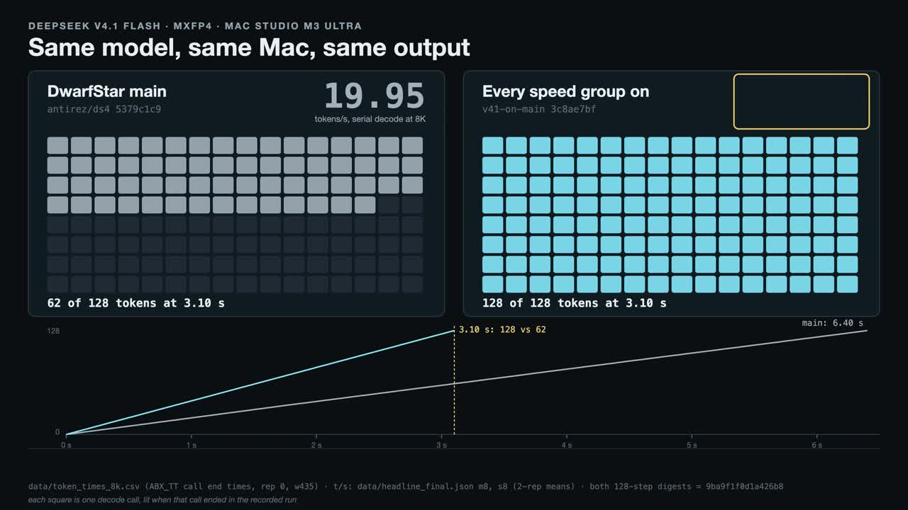

## DeepSeek V4.1 Flash on Metal, built on DwarfStar main

This branch is [antirez's DwarfStar](https://github.com/antirez/ds4) (main at
`5379c1c9`) plus a set of Metal speed-ups for DeepSeek V4.1 Flash. On a 512 GB
M3 Ultra with the MXFP4 build of the October 17 checkpoint, it decodes more
than twice as fast as main: **43.7 tok/s at 8K context and 42.8 at 131K**,
against main's 19.9 and 17.9. With DSpark drafting, code answers run at
**67.7 tok/s**. Several sessions now decode together: three sessions at once,
as a chat with two agents beside it, get **77.7 tok/s** in all through the
server, with DSpark on and DeepSeek's recommended sampling. A cold 131K-token
prompt takes **139.7 s**, against main's 189.5 s, and a 4K screenshot reaches
its first token in **2.9 s**.

The speed-ups come in 96 groups for the language model and 8 for image input.
Each group does one thing and has one switch that turns it off and runs main's
code instead. Groups are added on top of main in their own commits; from this
update on, one commit can hold several groups that share a mechanism.
A few defaults trade the last bits for speed, with a measured loss within
noise: MMA prefill attention, CED (the bounded decoder replay of DeepSeek's
V4.1 report) and, new in this update, decode attention on the matrix units, so
by default serial decoding no longer gives main's output bit for bit.
`--exact` (or `DS4_V41_EXACT=1`) turns off every default that is not bit for
bit, and then serial decoding from a given cache gives main's output bit for
bit; see [Exactness](#exactness). Decoding several sessions together never
changes what a session writes: each gets the bits it would get decoded alone.

[](https://github.com/IngeniousIdiocy/ds4-v41-m3ultra/releases/download/v41-video/v41-on-main-speedups.mp4)

The video's numbers were measured at tag [`v41-video`](https://github.com/IngeniousIdiocy/ds4-v41-m3ultra/tree/v41-video). Later defaults, such as MMA attention and CED, are not in it. Also available: [720p](https://github.com/IngeniousIdiocy/ds4-v41-m3ultra/releases/download/v41-video/v41-on-main-speedups-phone.mp4) · [subtitles](https://github.com/IngeniousIdiocy/ds4-v41-m3ultra/releases/download/v41-video/v41-on-main-speedups.srt) · [release page](https://github.com/IngeniousIdiocy/ds4-v41-m3ultra/releases/tag/v41-video)

Thanks to Ivan Fioravanti and Tarjei Mandt for their public V4.1 optimizations and for the ideas this work borrowed; [THIRD_PARTY-V41.md](THIRD_PARTY-V41.md) has the details.
Thanks also to the [oMLX](https://github.com/jundot/omlx) contributors: three pieces of the batched decode started in their V4.1 kernels.
Everything below the line further down is DwarfStar's own README, which
applies here unchanged.

### Speed

M3 Ultra (80 GPU cores, 512 GB), the MXFP4 1017 weights, a 393,216-token
context, on a quiet machine, one process at a time. Decode is 128 greedy tokens
after restoring an 8K or 131K prompt from a saved cache, so prefill is not timed,
with the drafter loaded; each figure is the mean of two timed passes. Prefill is
a cold prompt in an empty session, without the drafter.

| | DwarfStar main | this branch |
| --- | ---: | ---: |
| Serial decode, 8K | 19.9 t/s | **43.7 t/s** |
| Serial decode, 131K | 17.9 t/s | **42.8 t/s** |
| DSpark, prose, 8K | 18.6 t/s | **42.6 t/s** |
| DSpark, code, 8K | 26.5 t/s | **67.7 t/s** |
| Cold prefill, 32K | 45.0 s | **34.0 s** |
| Cold prefill, 131K | 189.5 s | **139.7 s** |
| A 2K-token follow-up onto an 8K cache | 5.8 s | **2.7 s** |

Prefill includes MMA attention and CED. With `--exact`, cold prefill takes
37.5 s at 32K and 150.8 s at 131K.

Image input is timed through `ds4-server` with the 1017 vision encoder
(`--vision`), the drafter and the disk KV cache loaded: a request with one image,
"Describe this image." and `max_tokens` 1, from sending it to receiving its one
token, on a warm server that has not seen the image. Each figure is the median
of four different images of that size. Main cannot load the 1017 vision file without
DwarfStar PR #1225 (below), so the left column is this branch with that PR and
image chats, before the image speed-ups.

| First token of an image request | before the image speed-ups | this branch |
| --- | ---: | ---: |
| 3840x2160 screenshot (1,002 prompt tokens) | 8.0 s | **2.9 s** |
| 1400x900 screenshot (806 prompt tokens) | 5.3 s | **2.2 s** |
| 512x507 image (218 prompt tokens) | 1.5 s | **1.0 s** |

The prose prompt is `speed-bench/promessi_sposi.txt` (an Italian novel); the
code prompt is DwarfStar's own C and Python source. The model continues each
one. This branch's figures come from one quiet session on this build. Main's
come from earlier quiet sessions, measured the same way with the same tool and
caches; main cannot restore the branch's saved drafter state, so its DSpark runs
start with a warm-up from main's own caches. The image figures' left column is
from the previous update's sessions. The previous release, our
earlier build of this work on an older DwarfStar, stays available as the tag
`v41-oct-release` of this repository.
[docs/REPRODUCE-V41.md](docs/REPRODUCE-V41.md) says how each number was taken.

A token takes about 23 ms on this branch at 8K, against about 50 ms on main.
Most of the difference is not arithmetic: it is time the GPU spent waiting for
the host, kernel launches that did very little work, and bytes read that were
wider than they needed to be. [docs/METAL-V41.md](docs/METAL-V41.md) explains
each group in those terms.

**Several sessions at once.** Through `ds4-server` with the launch shown under
[Quick start](#quick-start) (four batched sessions, the drafter on, temperature
1 and top_p 1, plus `--vision`), N sessions decode 256 tokens each, together,
from 2K- to 3K-token prompts of C source. The times include sampling on the
host and the server's own work between steps.

| Sessions decoding together, DSpark on | tok/s in all | tok/s per session |
| ---: | ---: | ---: |
| 3 | **77.7** | 26.0 |
| 1 | 43.9 | 43.9 |
| 2 | 68.7 | 34.6 |
| 4 | 90.9 | 22.8 |

When a cold 9,240-token prompt arrives while three sessions decode (greedily,
DSpark on), they keep going at about 10 tok/s each: its prefill took 17.7 s,
and the longest wait between two tokens of a decoding session was 336 ms (292 ms
at the 99th percentile). A cold 125,915-token prompt alone takes 145.4 s
through the server.

Decode alone, greedy, with DSpark off, in one resident process per engine, the
same 1,024-token prompts as token ids on both, against
[oMLX](https://github.com/jundot/omlx) v0.7.3 running DeepSeek's released
weights of the same checkpoint. Tokens per second for all sessions, from the
median step time of three runs:

| Sessions, DSpark off | this branch, oMLX benchmark prompts | oMLX | this branch, distinct prompts | oMLX |
| ---: | ---: | ---: | ---: | ---: |
| 3 | **83.2** | 63.9 | **81.2** | 62.6 |
| 1 | **44.2** | 38.6 | **44.1** | 38.4 |
| 2 | **67.4** | 59.5 | **66.1** | 58.5 |
| 4 | **92.2** | 77.0 | **88.7** | 74.1 |
| 8 | **122.4** | 113.7 | **113.7** | 105.3 |

oMLX's figures come from a quiet session of its own; its own benchmark command
uploads results, so it was not used.
[docs/REPRODUCE-V41.md](docs/REPRODUCE-V41.md#10-several-sessions-at-once) has
both methods.

### Hardware and memory

- **512 GB Mac:** tested. The MXFP4 model and its drafter stay resident. All
  numbers on this page come from an M3 Ultra with 512 GB.
- **256 GB Mac:** main's Q2 build (152 GiB of main weights) fits resident. The
  Q4 and MXFP4 builds (278 to 294 GiB of main weights) do not, and need main's
  SSD streaming. We have not measured either on 256 GB.
- **Every size:** the Engram tables (189 GiB) are never loaded into memory.
  Every mode reads their rows from the GGUF on disk as needed, so keep the model
  on a fast local SSD.

Our numbers are for MXFP4. Most groups apply to any V4.1 weights, but Q2's and
Q4's routed experts run on main's kernels, and we have not measured those
builds.

### Weights

Main's `download_model.sh` offers V4.1 Flash as Q2 and Q4, not MXFP4, and no
MXFP4 drafter for DSpark. Prepare the MXFP4 model and its drafter from the
public files in one command:

```sh
hf download antirez/deepseek-v4.1-flash-gguf --revision 9dcee51692e6540f697141fc98b097e3c96492a3 \
    --include 'DeepSeek-V4.1-Flash-1017-MXFP4-experts-*' --local-dir shards
hf download deepseek-ai/DeepSeek-V4.1-Flash-1017 --revision 1bae0e1088993b9b82de08f59de5be5a34e42170 \
    --include config.json tokenizer.json 'model-0004[456]-of-00048.safetensors' --local-dir dspark-source
python3 gguf-tools/deepseek41_prepare.py --shards shards --dspark-source dspark-source --out gguf
python3 gguf-tools/deepseek41_prepare.py --verify --out gguf
```

This merges the nine published MXFP4 files into
`gguf/DeepSeek-V4.1-Flash-MXFP4.gguf` (467.2 GiB) and converts the drafter into
`gguf/DeepSeek-V4.1-Flash-DSpark-MXFP4.gguf` (7.4 GiB). Every tensor byte of the
model is the published file's; `--verify` compares every tensor with pinned
digests. It needs about 544 GB free beside `--out`, Python 3.10 or later with
numpy, tokenizers and sympy, and `cc` and `make`.

To convert from the original checkpoint instead, use main's converter with the
two options this branch adds:

```sh
make -C gguf-tools libds4quants.dylib
python3 gguf-tools/deepseek41_quantize.py \
  --hf models/DeepSeek-V4.1-Flash-1017 \
  --source-revision 1bae0e1088993b9b82de08f59de5be5a34e42170 --quant mxfp4 \
  --out gguf/DeepSeek-V4.1-Flash-MXFP4.gguf \
  --dspark-out gguf/DeepSeek-V4.1-Flash-DSpark-MXFP4.gguf
```

`--quant mxfp4` keeps the checkpoint's own MXFP4 expert values, with no
calibration. `--dspark-out` writes the drafter with the tensor names main's
DSpark loader expects. A dry run of this conversion gives exactly the tensor
table and size of the prepared files. Main's own `deepseek41_dspark.py` writes a
different, wider drafter (8.04 GiB), which is not the one measured here.

### Upgrading from the previous release

After `git pull`, run `make` again. Then:

- **The model GGUF:** keep it. Its pinned digests have not changed.
- **The drafter:** convert it again. This build refuses the previous release's
  drafter at load (`DSpark support model and target checkpoint families differ`,
  or `invalid V4.1 DSpark weights`), because DwarfStar's DSpark loader expects
  other tensor names and a `dspark.target_architecture` key. The tensor data is
  the same. From the three drafter shards of the original checkpoint:

  ```sh
  hf download deepseek-ai/DeepSeek-V4.1-Flash-1017 --revision 1bae0e1088993b9b82de08f59de5be5a34e42170 \
      --include config.json tokenizer.json model.safetensors.index.json \
      'model-0004[456]-of-00048.safetensors' --local-dir dspark-source
  make -C gguf-tools libds4quants.dylib
  mv gguf/DeepSeek-V4.1-Flash-DSpark-MXFP4.gguf gguf/DeepSeek-V4.1-Flash-DSpark-MXFP4.old.gguf
  python3 gguf-tools/deepseek41_quantize.py --hf dspark-source \
    --source-revision 1bae0e1088993b9b82de08f59de5be5a34e42170 --quant mxfp4 \
    --dspark-out gguf/DeepSeek-V4.1-Flash-DSpark-MXFP4.gguf
  python3 gguf-tools/deepseek41_prepare.py --verify --out gguf
  ```

  `--verify` checks both files against the pinned digests.
- **Decode sidecars:** keep them. The scripts that write them have not changed,
  and the engine audits them at load.
- **The disk KV cache:** point `--kv-disk-dir` at a new, empty directory. Every
  old checkpoint is refused, because each is bound to the old drafter file and to
  the old numerics (main changed the router's softplus).
- **ds4-bench saved caches:** save them again. The old ones record the old
  drafter and the old numerics.
- **From the previous update of this branch:** run `make` again and keep
  everything else. The disk KV cache's numerics canary is the same, so its
  checkpoints still restore.
- **From this branch's earlier build** (tag `v41-video`): run `make` again and
  keep everything else. Text checkpoints in the disk KV cache are refused once
  and rebuilt, because MMA attention and CED change the numerics canary; with
  `--exact` they still restore.
- **Options and variables:** every command-line option is kept. The release's
  DSpark tuning variables (`DS4_DS41_DSPARK_*`,
  `DS4_DSPARK_DISABLE_ADAPTIVE_DRAFTING`), `DS4_METAL_V41_PREFILL_MMA` (MMA
  attention is now on by default; `DS4_METAL_DISABLE_V41_PREFILL_MMA=1` turns
  it off), `DS4_V41_ENGRAM_DECODE`, `DS4_METAL_ENABLE_V41_ROWS_ATTENTION`,
  `DS4_METAL_DECODE_INDEXER_SPARSE_THRESHOLD` and its fine-grained
  `DS4_METAL_DISABLE_V41_*` switches are no longer read; setting one does
  nothing. The group switches in [docs/RUNTIME-V41.md](docs/RUNTIME-V41.md)
  replace them: `DS4_METAL_DISABLE_FLASH_HEAD_SHARE` is now
  `DS4_METAL_DISABLE_V41_FLASH_HEAD_SHARE`, and
  `DS4_DISABLE_V41_ENGRAM_READERS32` is now `DS4_METAL_DISABLE_V41_ENGRAM_READERS`.

### Quick start

From the repository root:

```sh
make
./ds4 -m gguf/DeepSeek-V4.1-Flash-MXFP4.gguf --ctx 32768 \
  -p "Explain Redis streams in one paragraph."
./ds4-agent -m gguf/DeepSeek-V4.1-Flash-MXFP4.gguf
```

With DSpark, add the drafter:

```sh
./ds4 -m gguf/DeepSeek-V4.1-Flash-MXFP4.gguf --ctx 32768 \
  --mtp-model gguf/DeepSeek-V4.1-Flash-DSpark-MXFP4.gguf --dspark
```

As a server, with four sessions decoding together, the drafter, the disk KV
cache and the options this branch adds (the configuration the server figures
for several sessions were measured in, plus `--vision`):

```sh
./ds4-server -m gguf/DeepSeek-V4.1-Flash-MXFP4.gguf --metal \
  --host 127.0.0.1 --port 8000 -c 1048576 --prefill-chunk 8192 --batched-session 4 \
  --mtp-model gguf/DeepSeek-V4.1-Flash-DSpark-MXFP4.gguf --dspark --mtp-exact-sampling \
  --kv-disk-dir kvcache --kv-disk-space-mb 122880 \
  --kv-cache-cold-max-tokens 1048576 --kv-cache-continued-interval-tokens 4096 \
  --default-top-p 1.0 --default-min-p 0 --default-reasoning-effort low \
  --utility-ctx 32768 --serial-reasoning
```

`-c` is each session's context. This keeps about 380 GiB wired on a 512 GB Mac;
for one session, drop `--batched-session` and use a smaller `-c`.

Run the binaries from the repository root (or pass `--chdir`): the engine builds
its Metal kernels from `metal/` at startup. No environment variable is needed.
[docs/RUNTIME-V41.md](docs/RUNTIME-V41.md) lists every option and switch.

### The groups

Each group's switch is `DS4_METAL_DISABLE_V41_<NAME>=1` unless the row says
otherwise. "Decode" means one token at a time; "DSpark" means the six-row step
that checks a draft; "Batch" means one step that decodes several sessions
(`--batched-session`); "TP" means two Macs.

| Group | What it speeds up |
| --- | --- |
| `DS4_METAL_MODEL_TRACKED=1` | Decode, prefill: skips Metal's hazard tracking on the read-only weights. |
| `DS4_METAL_DISABLE_COMPUTE_TENSOR_COPY=1` | DSpark: small copies stay in the open compute encoder instead of a blit (every model). |
| DECODE_QUEUE | Decode: a step's layers queue into one command stream, so the GPU starts while the host still encodes. |
| ROUTER_SELECT | Decode, DSpark: the six experts are picked in one dispatch. |
| ENGRAM_ASYNC | Decode, DSpark: the Engram disk reads overlap the first layers instead of stalling the step. |
| FUSED_ROUNDING | Decode: bf16 rounding inside the kernels that produce the values. |
| NARROW_WEIGHTS | Decode: reads BF16 and FP8 copies of three weight families, half the bytes. |
| QKV_FUSION | Decode: the attention input projections and their norms in fewer passes. |
| ROPE | Decode: RoPE computed once per step and fused into its neighbours. |
| FFN_JOIN | Decode: the FFN outputs join the residual streams in one dispatch. |
| HC_FUSION | Decode: hyper-connection mixing fused into the kernels next to it. |
| SPLIT_REDUCE | Decode: two single-core reductions spread over the GPU. |
| SHARED_EXPERT | Decode, DSpark: the shared expert's gate, up and SwiGLU in one dispatch. |
| CONCURRENT_FFN | Decode: the shared expert runs beside the routed experts. |
| INDEX_SCORE_WIDE | Decode at depth: long index rows scored one key per thread (shared with GLM). |
| INDEX_BF16 | Decode at depth: index scoring reads a bf16 copy of the keys, half the bytes. |
| TOPK | Decode at depth: the top 512 by radix select across the GPU. |
| INDEX_CANDIDATES | Decode at depth: later layers score only the blocks layer 20 kept. |
| DECODE_ATTENTION | Decode: attention stages its rows straight from the cache, no copy. |
| FIXED_SHAPES | Decode: kernels built for V4.1's exact sizes. |
| SAMPLER_SCAN | Sampled decode: the sampler's first pass in NEON (every model). |
| ROW_MATMULS | DSpark: a few rows share one pass over the weights (every model). |
| ROWS_MMA | DSpark: a draft or verify block's three to eight rows on the matrix units. |
| VERIFY_KERNELS | DSpark: six to eight verify rows through the fused decode MoE kernels. |
| PUBLIC_CONTROLLER | DSpark: drafts only where drafting beats serial decoding. |
| MOE_DEDUP | DSpark: each expert read once for the rows that picked it (any MXFP4 model). |
| VERIFY_BATCH | DSpark, short prefill: rows attend and project as one batch. |
| FLASH_HEAD_SHARE | DSpark: eight attention heads share their key reads (every model). |
| VERIFY_INDEXED | DSpark: a draft block attends like a short prefill (the batched verify). |
| PREFILL_INDEX | Prefill: index scores on the matrix units, no barriers. |
| PREFILL_ATTENTION | Prefill: attention stages sixteen rows per barrier. |
| PREFILL_FOLDS | Prefill: rounding and glue kernels folded into their producers. |
| PREFILL_MATMUL | Prefill: Q8 weights unpacked to F16 once on the M3 Ultra. |
| PREFILL_INDEX_BATCH | Prefill: index candidates and top-k picked as batches. |
| SHORT_SWEEP | Prefill: 3,072 to 8,191 tokens in one sweep, with less decoder work. |
| ENGRAM_READAHEAD | Prefill: the next sweep's Engram reads start during this one. |
| ENGRAM_READERS | Prefill: 32 concurrent Engram readers instead of 16. |
| SUFFIX_TRIM | Prefill of 1,024 to 8,191 tokens: the decoder layers skip the rows inside a chunk that no later row reads. |
| PREFILL_MMA | Prefill: attention on the matrix units, 32 heads of a token at a time. Not bit for bit. |
| CED | Prefill: the decoder layers replay only a prompt's last 256 rows (the V4.1 report's bounded replay). Not bit for bit. |
| IMAGE_CED | Prefill: CED for prompts that hold images too. Not bit for bit. |
| IMAGE_TRIM | Prefill: SUFFIX_TRIM for prompts that hold images too, where CED is off. |
| MOE_SHORT_TILES | Prefill of 9 to 2,047 rows: the routed experts take the large-prefill tile kernels. |
| PREFILL_PIPELINE | Prefill: a one-chunk layer commits without waiting, so the host encodes the next layer while the GPU runs this one. |
| HC_NARROW | Prefill: the hyper-connection mix projection on narrow tiles. |
| CTX_RESIDENCY | Prefill: the engine's own buffers stay resident, so a request does not wait for the driver. |
| MOE_HALF_X | Prefill: the routed experts read their input rows as half, narrowed once per layer. |
| CARRY_KEEP | Prefill: one-chunk layers keep their rows in place instead of reloading them. |
| PREENCODE | Decode: the next token's first command buffer is encoded during this token's wait. |
| SAMPLER_GPU | Sampled decode: the top-p summary is computed on the GPU. |
| KEYED_SAMPLING | Sampled decode at top_p 1 (no top-k or min-p): each token is a Gumbel-max draw keyed to the seed and position (Tarjei Mandt's keyed sampling). Not bit for bit. |
| KEYED_GPU | Sampled decode at top_p 1: the GPU finds the few ids that can win the keyed draw, and the CPU scores only those. |
| FULL_PROBS | DSpark at top_p 1: the untruncated probabilities are the softmax in one pass, with no heap or sort. |
| PQ_GPU | DSpark at top_p 1: the draft and target distributions for the p/q verify, and the draws' candidates, are built on the GPU. |
| HEAD_ROWS | Batch: each session's vocabulary head at its one-row bits. |
| DECODE_ROWS | Batch: six to eight rows through the fused decode MoE kernels, at their one-row bits. |
| BATCH_FLUSH | Batch: the first command buffer commits after layer 0, so the GPU starts sooner. |
| ROWS_REG | Batch: two to four rows' Q8_0 products in registers, one pass over the weights. |
| BATCH_ROPE | Batch: the rows keep one-row decode's per-step RoPE tables. |
| BATCH_KV | Batch: the rows' KV rows roped, quantized and stored in one dispatch. |
| BATCH_TAIL | Batch: two to four rows' output projections expand straight into the hyper-connection streams. |
| BATCH_LOW | Batch: two to four rows' low projection in registers. |
| BATCH_NARROW | Batch: two to four rows read the BF16 router copy. |
| BATCH_HIER | Batch: two to four rows pick experts with the hierarchical router. |
| BATCH_OVERLAP | Batch: the mix and shared expert run beside the routed experts. |
| BATCH_DOWN | Batch: the shared down projection beside the routed sum. |
| BATCH_WAVE | Batch: the rows' attention stages run side by side, in waves. |
| BATCH_MIX | Batch: the hyper-connection mix beside q_b. |
| BATCH_STATIC | Batch: the routed experts on one-row decode's fixed-shape kernels. |
| BATCH_RBLOCK | Batch: the routed grids in row-block-major order (oMLX's order). |
| BATCH_EXPAND | Batch: the FFN join with its shape built in. |
| BATCH_QKV | Batch: q_a and kv side by side. |
| BATCH_MMA | Batch: five to seven rows on the exact eight-row matrix kernels. |
| BATCH_TAIL8 | Batch: BATCH_TAIL and BATCH_LOW through eight rows. |
| BATCH_DEFER8 | Batch: BATCH_OVERLAP through eight rows. |
| BATCH_ROUTER8 | Batch: BATCH_NARROW and BATCH_HIER through eight rows. |
| BATCH_QROPE | Batch: q_b of five to eight rows rotates as it stores. |
| BATCH_HEAD8 | Batch: the head of five to eight rows on sixteen SIMD groups. |
| BATCH_LOWBF | Batch: the low projection rounds to bf16 as it stores. |
| BATCH_PE | Batch: the next step's first command buffer is encoded during the final wait. |
| BATCH_NARROW_ENGRAM | Batch: two to eight rows read the Engram copy in one pass. |
| BATCH_READS | Batch: the second Engram table is read once the first has joined. |
| VERIFY_STACK | DSpark, batch: a verify block on the batch's FFN, Engram, router and head kernels. |
| VERIFY_COPIES | DSpark: a verify block's rollback and commit copies in one concurrent level. |
| VERIFY_DECODE | DSpark: a verify block attends with the decode kernels, so it gives serial decoding's bits. |
| MIXED_STEP | DSpark, batch: a verify block shares its step with other sessions' rows. |
| MIXED_CARRY | DSpark, batch: a rejected draft's correction rides in the next shared step. |
| READ_ONCE | DSpark, batch: rows that picked the same expert read it once. |
| FP4_NO_TABLE | Decode, batch: FP4 expert codes become floats by shifts, without a table (oMLX's decode). |
| LIVE_SPLITS | Decode, batch: attention launches only the splits that have keys. |
| FINAL_SPIN | Decode, batch: the host spins on the last command buffer's signal instead of waiting for completion. |
| ATTN_TILES | Decode, batch, DSpark: attention scores and PV on the matrix units (from oMLX's kernel). Not bit for bit. |
| TP_BALANCED_ROUTE | TP: each Mac takes half of every token's experts. |
| TP_SHARED_SPLIT | TP: the shared expert is split across both Macs. |
| TP_GATES | TP: partials go straight into the exchange slots. |
| TP_PREFILL_ROWS8 | TP prefill: the attention output rows in one dispatch. |

The two-Mac groups are built and unit-tested but not measured: no second Mac was
available.

Image input has its own groups. Their switches are read straight from the
environment:

| Switch | What it speeds up |
| --- | --- |
| `DS4_METAL_DISABLE_V41_VISION_HOST_PREP=1` | Image preparation (orientation, resize, normalization, patches) split by rows across the CPU cores. |
| `DS4_DISABLE_V41_VISION_PREP_REUSE=1` | Each request image is decoded and prepared once, not twice. |
| `DS4_DISABLE_PNG_SYSTEM_INFLATE=1` | PNG decoding through the system DEFLATE decoder and faster checksums, about three times faster. |
| `DS4_METAL_DISABLE_V41_VISION_ROUND_FOLD=1` | The encoder's bf16 rounding inside the kernels that make each value. |
| `DS4_METAL_DISABLE_V41_VISION_ATTN_EXACT=1` | The encoder's exact attention takes 32 keys per step instead of one. |
| `DS4_METAL_DISABLE_V41_VISION_ATTN_FLASH=1` | The encoder's attention on the matrix units, softmax in registers, K and V read as half. Not bit for bit. |
| `DS4_METAL_DISABLE_V41_VISION_ATTN_LAZY=1` | Flash attention rescales its output only when a row's maximum grows. |
| `DS4_METAL_DISABLE_V41_VISION_ATTN_KT16=1` | Flash attention walks the keys 16 at a time. |

### Exactness

Every group has an off switch. Three defaults are not bit for bit with
DwarfStar main, two in prefill and one in decode:

- **PREFILL_MMA** runs prefill attention on the matrix units, which adds in a
  different order.
- **CED** replays only a prompt's last 256 rows through the 20 decoder layers,
  as DeepSeek's V4.1 report does (its causal encoder-decoder with bounded
  replay); IMAGE_CED does the same for prompts that hold images.
- **ATTN_TILES**, new in this update, runs decode attention's scores and PV on
  the matrix units, which also adds in a different order. Serial decoding from
  a given cache therefore no longer gives main's output bit for bit by default;
  with `--exact` it does.

Their cost is within noise. After each of 29 follow-ups of 1K tokens, from 3K
to 32K, the next token was the same as the exact prefill's, with a mean
full-vocabulary KL divergence of 0.014 on prose and 0.0009 on code (at most
0.081 and 0.0091). Over 21 long DeepSeek V4.1 scoring cases, the mean negative
log-likelihood per token is 0.3003 against 0.3010 with exact prefill (prose
0.4452 against 0.4487, code 0.1910 against 0.1896). These were measured with
the groups through PREFILL_PIPELINE; the four prefill groups after it give the
same bits as the code they replace, so the figures hold for this build.
ATTN_TILES on top of them: over the same 21 cases, 0.2993 against 0.3003 with
main's decode attention. Greedy decoding of 16 prompts, compared with main's
attention step by step until the tokens differed, took 735 steps in all, with a
mean KL divergence of 0.00175 (at most 0.035); 14 of the 16 reached a different
token.

**One switch for main's bits.** `--exact` on `ds4` and `ds4-server`, or
`DS4_V41_EXACT=1` for any tool, is off by default. It turns off every default
that is not bit for bit, so prefill, serial decoding and DSpark all give main's
serial output:

- PREFILL_MMA, CED and IMAGE_CED (prefill);
- INDEX_SCORE_WIDE and TOPK (decode at depth), and INDEX_CANDIDATES, which
  needs them;
- ROWS_MMA and VERIFY_INDEXED (DSpark), and DSpark drafting itself, as
  `--dspark-strict` does;
- VISION_ATTN_FLASH (the vision encoder's attention);
- ATTN_TILES (decode attention);
- KEYED_SAMPLING, KEYED_GPU, FULL_PROBS and PQ_GPU (sampling at top_p 1), so a
  sampled decode draws with main's sampler.

With `--exact`, the logits after cold prefills of 8, 8K, 32K and 131K tokens
are main's for the same token ids, and so are 256 greedy steps of tokens and logits from main's own
8K cache, with or without the drafter loaded. A disk KV checkpoint written in
one mode is refused in the other, so an exact session never continues from
state the faster defaults wrote.

Through the progression below, with every group on except PREFILL_MMA and CED,
serial decoding gave DwarfStar main's logits bit for bit: every one of 128
greedy steps from main's own saved caches at 8K and 131K prose, at every step,
and the logits after a cold 32K prefill. (ATTN_TILES came later.) Short prompts are exact too: after prompts of
three to eight tokens the logits and the next 32 greedy tokens are main's.
Strict DSpark gives the serial tokens.

One switch exists only for exactness. An eight-token prompt is prefilled as one
batch of eight rows, and SHORT_MMA runs that batch on the matrix units in main's
order of sums, so it gives main's bits at the speed of the faster kernels it
replaced. `DS4_METAL_DISABLE_V41_SHORT_MMA=1` runs main's own kernels instead,
with the same output.

**Several sessions at once.** Every batch group gives each session's row the
bits of that session decoded alone with the same switches, sampled or greedy,
so batching never changes what a session writes. Each group was checked by
hashing every row's full logits at every step against that session's own
one-row run, at two to eight rows, at short depth and at 34K to 300K.

**DSpark.** DSpark's default mode keeps the state of the batched verify. On
main the batched verify is not bit for bit equal to decoding one token at a
time, so greedy DSpark output can differ from serial output where two tokens
are nearly tied. Here a verify block now attends with the decode kernels
(VERIFY_DECODE) and runs on the decode stages (VERIFY_STACK), so with the
defaults greedy DSpark gives serial decoding's tokens: its verify logits equal
serial decoding's at 44 places from a few hundred tokens to 400K, and greedy
DSpark wrote serial decoding's 512 tokens on each of five texts. With
VERIFY_STACK or VERIFY_DECODE off the old difference returns, and
`DS4_METAL_DISABLE_V41_VERIFY_INDEXED=1` verifies row by row instead.

The groups that are not bit for bit:

- **PREFILL_MMA**, **CED** and **IMAGE_CED** (above).
- **VISION_ATTN_FLASH**: the vision encoder's attention on the matrix units, in
  float with a different order of sums. See image input below for its
  accuracy.
- **ATTN_TILES** (above). A batched row still equals its session decoded
  alone, since one-row decode takes the same kernel.
- **VERIFY_INDEXED** and **ROWS_MMA**, only with VERIFY_STACK or VERIFY_DECODE
  off: then the batched verify and the matrix units' order of sums can change a
  verify row's last bits. With the defaults a verify block gives serial
  decoding's bits (above). ROWS_MMA runs only inside DSpark; prefills never
  take it.
- **VERIFY_KERNELS**: verify rows now carry the bits of each row decoded alone,
  instead of main's batch kernels' bits, so DSpark's tokens can differ from
  main's DSpark.
- **PUBLIC_CONTROLLER**: a different drafting policy by design; it changes
  where DSpark drafts.
- **DECODE_QUEUE with DSpark**: in the previous release, turning it off changed
  DSpark's verify bits, while the tokens stayed the same. (SHORT_SWEEP, listed
  here before, gives main's logits: with `--exact`, cold prompts of 3,072,
  4,096, 6,144 and 8,000 tokens match main bit for bit.)
- **INDEX_SCORE_WIDE**: the wide scorer adds the index heads in a different
  order, so a key near the top-512 cut-off could change. In every check, the
  selections and logits stayed the same.
- **KEYED_SAMPLING** and the top_p 1 sampler groups after it: the same logits
  and the same distribution, but a different random draw from main's sampler,
  so sampled tokens differ. Greedy decoding never takes them. FULL_PROBS sums
  the softmax in another order (within 2.3e-6 of a double-precision softmax).

[docs/RUNTIME-V41.md](docs/RUNTIME-V41.md) gives the exactness of every switch.

### Image input

- **The 1017 vision encoder.** DwarfStar PR #1225 (by nazeshinjite) pairs a
  V4.1 vision file with its language checkpoint by revision, so the encoder
  released with the 1017 checkpoint loads beside the 1017 model.
- **WebP images** on macOS, through ImageIO (DwarfStar PR #1197, by joohooo).
- **Image chats in the disk KV cache.** A checkpoint of a chat that holds
  images also stores each image's fingerprint, its rows and its place in the
  text, and its file name covers them. A later request restores it only when
  its images are the same, at the same places, from the same encoder running
  the same numerics; another image behind the same text misses and is read
  again. A restored prefix skips the encoder for the images it already holds.
- **Faster images.** The groups above take a 4K screenshot's first token from
  8.0 s to 2.9 s: preparation on every core, one decode per image, a
  faster PNG decoder, the encoder's attention on the matrix units, and CED and
  the short-prefill groups for the prompt that follows.
- **Image accuracy.** On 216 exactly scored questions about 42 rendered images
  (charts, tables, dark interfaces, layout and small text, at 720x450 to
  3840x2160), the defaults answered 176 correctly and `--exact` 177: no
  measurable loss. Five answers differed, all readings of characters 9 to 11
  pixels tall; in four both modes were wrong, and in one a 9-pixel "8" was read
  as "B". The set has rendered images only (no photos), short answers and one
  image per request. Use `--exact` where bit-for-bit output matters.

### New in this update

- **Several sessions decode together.** With `--batched-session N`, `ds4-server`
  keeps N sessions resident and decodes every session that is ready in one step:
  each layer's weights are read once for all of them. A chat with two agents
  working beside it, the case this update was built for, gets 77.7 tokens per
  second in all, against 43.9 for one session alone (DSpark on, temperature 1,
  top_p 1, through the server). Each session's output is bit for bit what it
  would be decoded alone, sampled or greedy, at every depth checked, so batching
  never changes what a session writes. Two to four rows run on register kernels
  that read each weight once and keep every row's own order of sums; five to eight
  rows run on the exact eight-row tiles. The groups are explained under
  "Several sessions at once" in [docs/METAL-V41.md](docs/METAL-V41.md#several-sessions-at-once).
- **DSpark inside a batch.** A session with the drafter loaded keeps drafting
  while other sessions decode: its verify block leads the step and the other
  sessions follow as plain rows, and a rejected draft's correction becomes that
  session's row in the next step instead of a step of its own. While three or
  fewer sessions decode, they take turns drafting, one block a step; with more,
  every session decodes plain rows. A verify block now
  attends with the decode kernels, so DSpark's greedy output is serial decoding's,
  bit for bit, at every depth checked from a few hundred tokens to 400K.
- **Expert weights read once for the rows that share them.** When two rows pick
  the same expert, one load feeds both rows' sums, in each row's own order. A
  verify block repeats a third of its experts, so blocks always take it; plain
  rows take it from four sessions.
- **Faster decode for one session too.** The routed experts decode their FP4
  weights with shifts instead of a table behind a barrier, decode attention runs
  its scores on the matrix units (not bit for bit; `--exact` keeps main's
  kernel), only attention splits that have
  keys launch, and the host spins on the last command buffer's event instead of
  waiting for its completion. Serial decode at 8K is now 43.7 tok/s, against
  41.4 in the previous update.
- **Prefill no longer stalls the other sessions.** A cold prompt now prefills in
  32,768-token syncs and parks between chunks, and the decoding sessions take a
  step at every park. Beside three decoding sessions, a cold 9,240-token prompt
  prefilled in 17.7 s while they kept decoding, and the longest wait between two
  of their tokens was 336 ms. A title or a short
  append no longer waits for a cold prefill to finish: it gets the model between
  chunks.
- **The utility session beside batched sessions.** `--utility-ctx` now works with
  `--batched-session`: the utility row joins the batch, so titles and summaries
  run beside the chats instead of waiting for them.

### In the previous update

- **Prompts exactly as DeepSeek's encoder writes them.** For the same chat
  request, ds4 now produces the token ids that the 1017 checkpoint's
  `encoding/encoding.py` and `tokenizer.json` produce. Before, a 102K-token agent
  chat with tools and images came out 204 tokens shorter than the reference, for
  three reasons, all fixed:
  - the tools block had its own wording and JSON style and came before the
    system prompt; it now follows the encoder's template, after the system
    prompt;
  - content blocks were joined with nothing between them; they are now joined
    with a blank line, as the encoder does (both the Anthropic and OpenAI
    endpoints);
  - the tokenizer treated only ASCII as punctuation, so text such as `.”` or `…`
    split into the wrong tokens; it now pre-tokenizes with the Unicode classes of
    `tokenizer.json`.

  Also: images in parallel tool results that arrive out of order are bound in
  prompt order instead of failing, earlier turns' reasoning is dropped when a
  request declares no tools (keeping the current turn's), and other models'
  special spellings such as `[gMASK]` stay plain text. Tests check 30 requests
  against the encoder token for token, and the tokenizer against
  `tokenizer.json` on 22,298 texts (27 million tokens). Prompts with tools,
  several blocks or non-ASCII punctuation change, so their saved caches miss
  once.
- **DeepSeek's recommended sampling, at full speed.** DeepSeek recommends
  temperature 1 and top_p 1.0 for the 1017 checkpoint, and the server example
  above uses it. At top_p 0.95, a run of repeated text can become
  permanent: once the next repeated token is above 0.95 probability, every
  other token is cut, so the model can never leave it. At 1.0 it escapes. Before
  that update top_p 1.0 was slower, because it sampled the full vocabulary on
  the CPU. The four sampler groups above make it as fast as 0.95 or faster.
  Sampling a token at top_p 1.0 now costs about 1 µs, against 12 to 14 µs for
  the top-p selector and about 320 µs on the previous CPU path. DSpark at top_p
  1 verifies drafts with the p/q test, with both distributions built on the
  GPU.
- **Memory.** Metal objects autoreleased on ds4's C threads were never freed, so
  a long-running server's footprint grew with every session. This carries
  DwarfStar PR #1244 (a pool around the tensor contents, write and read
  helpers) and adds a pool at every engine entry point.
- **No private mapping of a served model.** Tools that read only a model's
  metadata (the tokenizer dump, inspect-only engines, sidecar probes) mapped
  the GGUF privately. On macOS a private mapping of a file that a running Metal
  server holds wired is copied into anonymous memory, hundreds of GB for this
  model, which can exhaust memory and panic the machine. They now map it shared
  and read-only; only CPU inference keeps the private mapping.
- **Disk KV cache.** Long V4.1 prefills store continued checkpoints as they go,
  so a long prompt that diverges from the last one no longer re-prefills from
  the start. The eviction ladder is back: old anchors age out on a half-life,
  and a chat's superseded waypoints are thinned to a geometric ladder.
- **OpenAI streaming.** A stream no longer finishes with `tool_calls` when no
  call was emitted, and text withheld for a tool block that never parsed is
  sent instead of dropped.

### Also carried from the previous release

- **ds4-server:** `--utility-ctx N` keeps a small second session for
  `"ds4_utility": true` requests (titles, summaries) that never disturb the main
  session. `--serial-reasoning` decodes reasoning serially and drafts only
  answers and tool calls. `--default-top-p`, `--default-min-p` and
  `--default-reasoning-effort` set request defaults. See
  [serving](docs/SERVER.md#request-defaults-utility-requests-and-serial-reasoning).
- **The disk KV cache, version 2:** a checkpoint is bound to the model and
  drafter files that wrote it, to a hash of its payload and to a numerics canary
  run at startup, so a checkpoint from other weights, other kernels or a damaged
  file is refused instead of loaded. A request that extends a restored prefix
  saves the deeper checkpoint. With the drafter loaded, a saved session also
  carries the drafter's window, so a restored session drafts at once. Caches
  written by main's version 1 store are refused.
- **Decode sidecars:** `--v41-sidecar FILE` loads DeepSeek's released BF16
  router, FP8 Engram or FP8 indexer values in place of the copies built at load.
  See [the gguf-tools guide](gguf-tools/README.md#v41-decode-sidecars).
- **ds4-bench:** sampled decoding (`--temp`, `--top-p`, `--top-k`, `--min-p`,
  `--seed`), per-token timings and digests (`--token-csv`), a resident job
  runner (`--jobs`) and saved caches that are checked on every load. See
  [performance](docs/PERFORMANCE.md#sampled-runs-digests-and-the-job-runner).

### Not included

- **The previous release's own DSpark runtime.** Main now has its own V4.1
  DSpark, and this branch keeps it. Only the release's drafting policy is
  ported, as PUBLIC_CONTROLLER. Its tuning variables, fault injection and
  deferred drafter upkeep went with the old runtime.
- **The shift decode of Engram codes**: an experiment that was off by default
  and did not earn a place. (The previous release's other opt-in experiment,
  the prefill attention on matrix units, is now the PREFILL_MMA group.)
- **One routed-expert tile per expert for short prefills**: identified and
  sized, not built. [docs/METAL-V41.md](docs/METAL-V41.md#identified-not-built)
  describes it.
- **Dense attention up to 1,024 compressed rows.** Main deliberately selects the
  model's top 512 as soon as there are more than 512 index rows, because
  attending to more changes the output. This branch keeps main's rule.
- **A two-Mac fix to main's own batch MoE call**, which can only be checked on
  two Macs; it is left for a separate fix to main.
- **The release's rows attention for short prefills**: no speedup was measured,
  and it changes prefill logits.

[CHANGES-V41.md](CHANGES-V41.md) lists every commit and everything that moved
since the previous release.

### Progression

Each step turns on more groups, in commit order, on top of the step before. All
steps were measured as in the speed table, in one quiet session (prefill step 9
in a short second session right after it).
[docs/METAL-V41.md](docs/METAL-V41.md) explains each step.

Decode, in tokens per second:

| Step | Groups added | Serial 8K | Serial 131K | DSpark code 8K | DSpark prose 8K |
| --- | --- | ---: | ---: | ---: | ---: |
| main | | 19.9 | 17.9 | 26.5 | 18.6 |
| 1 | MODEL_TRACKED | 20.2 | 18.2 | 30.1 | 19.2 |
| 2 | COMPUTE_TENSOR_COPY | 20.6 | 18.6 | 31.3 | 19.6 |
| 3 | DECODE_QUEUE | 27.6 | 24.3 | 32.0 | 23.1 |
| 4 | ROUTER_SELECT | 29.2 | 25.5 | 32.6 | 23.9 |
| 5 | ENGRAM_ASYNC | 29.2 | 25.1 | 39.8 | 25.4 |
| 6 | FUSED_ROUNDING | 30.6 | 26.5 | 39.9 | 26.3 |
| 7 | NARROW_WEIGHTS | 31.5 | 27.2 | 39.9 | 26.6 |
| 8 | QKV_FUSION, ROPE, FFN_JOIN | 32.8 | 28.1 | 40.6 | 27.3 |
| 9 | HC_FUSION | 36.2 | 30.6 | 41.1 | 28.9 |
| 10 | SPLIT_REDUCE, SHARED_EXPERT, CONCURRENT_FFN | 37.5 | 31.5 | 41.6 | 29.5 |
| 11 | INDEX_SCORE_WIDE, INDEX_BF16 | 37.6 | 34.1 | 41.8 | 29.6 |
| 12 | TOPK | 37.9 | 36.6 | 42.2 | 29.9 |
| 13 | INDEX_CANDIDATES, DECODE_ATTENTION | 38.9 | 38.1 | 43.3 | 30.4 |
| 14 | FIXED_SHAPES | 41.1 | 40.3 | 43.3 | 31.2 |
| 15 | SAMPLER_SCAN, ROW_MATMULS | 41.2 | 40.3 | 48.2 | 32.4 |
| 16 | ROWS_MMA, VERIFY_KERNELS | 41.2 | 40.3 | 53.9 | 33.7 |
| 17 | PUBLIC_CONTROLLER | 41.2 | 40.3 | 52.5 | 40.3 |
| 18 | PREFILL_INDEX, PREFILL_ATTENTION, PREFILL_FOLDS, MOE_DEDUP | 41.2 | 40.3 | 52.6 | 40.3 |
| 19 | VERIFY_BATCH, FLASH_HEAD_SHARE | 41.2 | 40.3 | 54.0 | 40.2 |
| 20 | PREFILL_MATMUL, PREFILL_INDEX_BATCH, SHORT_SWEEP, ENGRAM_READAHEAD, PREENCODE | 41.4 | 40.5 | 54.0 | 40.5 |
| 21, all on | SAMPLER_GPU, the four TP groups, VERIFY_INDEXED, ENGRAM_READERS | 41.4 | 40.5 | 59.0 | 40.5 |

Cold prefill of 32K tokens, in seconds:

| Step | Groups added | 32K |
| --- | --- | ---: |
| main | | 45.0 |
| all off | this branch with every group off | 45.0 |
| 1 | the decode and DSpark groups through PUBLIC_CONTROLLER | 44.9 |
| 2 | PREFILL_INDEX | 43.5 |
| 3 | PREFILL_ATTENTION | 42.2 |
| 4 | PREFILL_FOLDS | 40.9 |
| 5 | MOE_DEDUP, VERIFY_BATCH, FLASH_HEAD_SHARE | 40.9 |
| 6 | PREFILL_MATMUL | 40.7 |
| 7 | PREFILL_INDEX_BATCH | 40.4 |
| 8 | SHORT_SWEEP, ENGRAM_READAHEAD and the decode groups PREENCODE through VERIFY_INDEXED | 40.4 |
| 9, all on | ENGRAM_READERS | 37.9 |

A cold 131K prefill takes 189.5 s on main (a later quiet session), 189.4 s with
every group off and 151.6 s with every group on.

The prefill groups from SUFFIX_TRIM on came after the progression. Their gains
are measured one by one in [docs/METAL-V41.md](docs/METAL-V41.md#prefill-after-the-progression);
together they take a cold 32K prefill from 37.9 s to 33.7 s and 131K from
151.6 s to 138.8 s, and a 2K-token follow-up onto an 8K cache from 4.8 s to
2.7 s.

The groups of this update, HEAD_ROWS through ATTN_TILES, came after the
progression too. [docs/METAL-V41.md](docs/METAL-V41.md#several-sessions-at-once)
gives each one's gain as it was added, and the speed table above is this build.

After the progression session, ROWS_MMA and VERIFY_KERNELS were limited to
DSpark's rows; before, they also took an eight-token prefill, which was fast but
not main's bits. That change and the SHORT_MMA exactness switch (see Exactness)
were measured against the previous head with every group on, in alternating
processes: an eight-token prefill takes 0.3 s, as before, and now gives main's
logits; a cold 32K prefill takes 37.8 s, under 0.1 s from before; DSpark code at
8K runs at 59.2 t/s, within 0.1 t/s of before and within run-to-run noise.

Groups that share a row were measured together: they have little or no effect on
that row's measurements alone, and the TP groups and SAMPLER_GPU cannot change
greedy decoding on one Mac. Every serial step gave main's digest of 128 steps of
tokens and full logits at both depths, and every prefill step gave main's logits.
Main's DSpark row comes from main's own caches with a warm-up, in a later quiet
session, while the steps run from caches that carry the drafter window
with no warm-up, so the jump from main to step 1 is partly a change of method.

### Tests

```sh
make tests/test_deepseek41_metal
./tests/test_deepseek41_metal --v41-groups      # one check per group, no model
make test-deepseek41-verify-indexed DS4_TEST_MODEL=gguf/DeepSeek-V4.1-Flash-MXFP4.gguf \
  DS4_TEST_DSPARK=gguf/DeepSeek-V4.1-Flash-DSpark-MXFP4.gguf
```

[docs/RUNTIME-V41.md](docs/RUNTIME-V41.md#tests) lists the other V4.1 tests.

### V4.1 documents

- [docs/METAL-V41.md](docs/METAL-V41.md): what each group does and why it is faster, the
  groups that decode several sessions at once, and one speed-up identified but not built.
- [docs/RUNTIME-V41.md](docs/RUNTIME-V41.md): every option and switch.
- [docs/REPRODUCE-V41.md](docs/REPRODUCE-V41.md): how the numbers were measured.
- [docs/FAILED-EXPERIMENTS-V41.md](docs/FAILED-EXPERIMENTS-V41.md): the ideas that were built and measured and did not pay, and why.
- [CHANGES-V41.md](CHANGES-V41.md): the commits, and what changed since the previous release.
- [THIRD_PARTY-V41.md](THIRD_PARTY-V41.md): where the pieces came from.
- [.claude/skills](.claude/skills): three skills for Claude Code and Codex users optimizing Metal inference: decode, prefill and speculative decoding.
- [history/previous-release](history/previous-release/README.md): the previous release's experiments, receipts and release notes, kept unchanged as the record.

---

<p align="center">
  
</p>

**DwarfStar** aims to be the best way to run a few excellent large
language models on consumer hardware (that is, hardware that people
can actually own). To reach this goal, we are building
a small native inference engine optimized first for
**DeepSeek V4 Flash** (including the experimental vision model),
**DeepSeek V4.1 Flash** (Metal, and text inference on CUDA),
and additionally **GLM 5.2 and 5.3**, **GLM 5.3 Flash** and
**DeepSeek V4 PRO**, and **Qwen3.8 Flash Next** (Metal and CUDA). The code is self-contained and
deliberately narrow, not a general GGUF runner: you need to use the
GGUF files the project produces, that are part of the project
itself.

We test things in integration: model loading, prompt rendering,
tool calls, KV state, the HTTP server, and the coding agent are built and tested together.
The repository also includes tools and data for GGUF, imatrix, quality, and speed.

## Supported hardware

* **Metal**, the primary target, on Macs with 64 GB (for Qwen Flash next) and 96 GB or more (for DeepSeek and GLM). Smaller machines can use SSD streaming. SSD streaming is also needed in order to run very large models such as full GLM 5.x (not Flash) on 128GB systems.
* **NVIDIA CUDA**, the DGX Spark is our main gaol. DwarfStar also supports multi-GPU systems that are not supported by other backends, for instance it can run DeepSeek v4 Flash on Ada Lovelace cards.
* **ROCm** on Strix Halo systems such as the Framework Desktop.

This project would not exist without **llama.cpp and GGML**, make sure to read
the acknowledgements section, a big thank you to Georgi Gerganov and all the
other contributors.

**Model support is intentionally opportunistic**. The project follows the best open
weights for useful local machine sizes, especially 128 GB laptops and 256/512 GB
workstations. A model may be removed when a better replacement arrives.

# So, what can I do with this software?

* You can run a very capable models in your consumer hardware, a MacBook, a DGX Spark, or a Strix Halo for example. Even if you have not enough RAM, with SSD streaming, you can run it at a decent speed.
* You can use multiple CUDA cards as a multi-user LLM server. Ada Lovelace, including L40S, is supported: newer models can run here even when their other inference implementations require newer GPUs. Our eight-L40S Flash setup has reached about 126 t/s aggregate generation with 16 sessions.
* Using two 128 GB Macs connected with RDMA, you can run 4-bit DeepSeek Flash or GLM 5.3 Flash with tensor parallelism. Larger GLM 5.2 quants need larger machines, such as Mac Studios.
* You can also use pipeline paralellism to glue together multiple systems to sum their RAM and run larger models.

## Motivations

* Capable open-weight models now fit on high-end personal machines.
* DeepSeek V4 Flash and PRO, GLM 5.2, tolerate aggressive routed-expert quantization.
* Compressed KV caches and fast local SSDs make long contexts practical.
* The idea of an inference system specialized for a few models.

# AI full disclosure

* This software is developed with **strong assistance from AI coding agents** and with humans leading the ideas, testing, and debugging. We say this openly because it shaped how the project was built. If you are not happy with AI-developed code, this software is not for you. The acknowledgement below is equally important: this would not exist without `llama.cpp` and GGML, largely written by hand.

## Acknowledgements to llama.cpp and GGML

`ds4.c` does not link against GGML, but it **exists thanks to the path opened by the
llama.cpp project and the kernels, quantization formats, GGUF ecosystem, and hard-won
engineering knowledge developed there**.
We are thankful and indebted to [`llama.cpp`](https://github.com/ggml-org/llama.cpp)
and its contributors. Their implementation, kernels, tests, and design choices were
an essential reference while building this DeepSeek V4 specific inference path.
Some source-level pieces are retained or adapted here under the MIT license: GGUF
quant layouts and tables, CPU quant/dot logic, and certain kernels. For this
reason, and because we are genuinely grateful, we keep the GGML authors copyright
notice in our `LICENSE` file.

## Status

The software is currently very fast changing. Consider it beta quality.
Before each release, a big QA run is executed, however instabilities
and regressions are definitely possible.

# How to use this project?

I (Salvatore) believe that the way projects should be shipped and used changed because of AI. The main differences today are:

1. With AI, users can modify the software in significant ways with low efforts, costs, and even lacking deep domain knowledge about the task they want to accomplish. For instance, a DwarfStar user with a specific hardware setup can ask a coding agent to improve the inference speed of this software for the specific hardware setup, asking the model to reach the maximum prefill and generation speed without impacting correctness, and also asking to do a deep QA pass.
2. Similiarly, because of "1", software may be shipped in a different way than before. It must be more a working template for the biggest use cases, without trying to cover every possible setup. If DwarfStar showcases a few good implementations of tensor parallel execution, the code will work as a rail for implementing the same feature in specific conditions, for a new model, and so forth.

So, while this project attempts to be usable for the featured models and the most common hardware setups, I ask you, if you have access to coding agents, to consider using coding agents as an interface to discover the project, make modifications, create personalized setups. This way you can likely do more than what we ship, and certain things that are not documented or implemented, and that you require, are potentially very easy to achieve.

## Start Here

```sh
git clone https://github.com/IngeniousIdiocy/ds4-v41-m3ultra.git
cd ds4-v41-m3ultra
```

Choose your build. The platform guides cover prerequisites, memory sizing,
and hardware-specific setups:

| Platform guide | Build |
| --- | --- |
| [Metal on Apple Silicon](docs/METAL.md) | `make` |
| [DGX Spark](docs/DGX_SPARK.md) | `make cuda-spark` |
| [Strix Halo / Framework Desktop](docs/STRIX_HALO.md) | `make strix-halo` |
| [One or more CUDA cards, including Ada/L40S](docs/CUDA_MULTI_GPU.md) | `make cuda-generic` |

For a first run on a 96 or 128 GB machine, download DeepSeek V4 Flash Q2:

```sh
./download_model.sh ds4f-q2
```

Downloads go in `gguf/`. Repeat the command to resume an interrupted download.
Leave memory for the context and runtime buffers as well as the model.
See [other models](docs/MODELS.md) or use [SSD streaming](docs/SSD_STREAMING.md)
on a smaller Mac.

## Everyday Use

Once built and with a model downloaded:

```sh
./ds4
./ds4 -p "Explain Redis streams in one paragraph."
./ds4-agent
./ds4-server --ctx 32768
```

The default model is `ds4flash.gguf`, a link updated by main-model downloads.
Pass `-m FILE` to choose explicitly. Commands normally run from the repository
root; use `--chdir /path/to/ds4` when launching elsewhere.

The server listens at `http://127.0.0.1:8000` by default; see [serving](docs/SERVER.md)
for API access and multiple sessions.

The interactive CLI keeps a multi-turn conversation. Use `/help`, `/read FILE`,
`/ctx N`, and `/quit`. Ctrl+C interrupts generation and returns to the prompt.
Run each binary with `--help` for its full options.

### Native coding agent

`ds4-agent` runs inference directly, without a separate HTTP server. It keeps
the token history and live model state together, shows prefill progress, and
uses the model's native tool format. DeepSeek and GLM have their own templates.

Use `/hints on` for occasional, brief explanations of the programming choices
behind the work, and `/hints off` to stop them. Changes take effect at the next
conversation boundary without rebuilding the cached context. New and resumed
sessions start with hints off.

Sessions are stored in `~/.ds4/kvcache`:

| Command | Action |
| --- | --- |
| `/save` | Save the current session |
| `/list` | List saved sessions |
| `/switch <sha>` | Resume a session |
| `/del <sha>` | Delete a saved session |
| `/strip <sha>` | Keep text and title, removing the large KV payload |

Compatible local KV snapshots avoid rebuilding the prompt. Stripped sessions
and network TP restores require prefill. Sessions containing images cannot yet
be saved. Saved conversations and traces may contain private information.

For Pi, OpenCode, Codex CLI, or Claude Code, use `ds4-server` instead and follow
the [client setup guide](docs/CLIENTS.md).

### Models, images, and speculation

[Models and vision](docs/MODELS.md) lists the supported downloads and memory
requirements. DeepSeek Vision Experimental uses a different checkpoint from
Flash 0731; GLM 5.3 Flash and Qwen3.8 Flash Next add vision to the same text
model through a separate encoder.

DeepSeek V4.1 Flash text and vision run on Metal; text also runs on a DGX Spark.
Q2 runs with SSD streaming on one 128 GB Mac or Spark, or resident across two
Macs or two Sparks using RDMA. Q4 needs SSD streaming or a 512 GB Mac.
Engram tables remain on disk in every mode, so use a fast
local SSD. See the [model guide](docs/MODELS.md#deepseek-v41-flash) for downloads
and setup.

With the matching encoder passed as `--vision FILE`, use `/read image.png`
in the CLI or `view_image` in the native agent.

Qwen3.8's smaller Q2 release has **41.73 GiB** of main/MTP weights,
with imatrix IQ2_XXS gate/up experts and padded Q2_K down projections.
It is the starting option for 64 GB Macs.
The GGUF also contains 95.37 GiB of original BF16 n-grams, read directly
from disk rather than loaded into RAM. Keep it on a fast SSD. Start with 8K context:

```sh
./download_model.sh qwen38-q2
./ds4 --ctx 8192 --prefill-chunk 1024
```

The download fetches one 137.10 GiB file and updates `ds4flash.gguf`.
Add `--mtp` for speculative decoding. The larger
`qwen38-q4k` target is also available. Download the optional vision encoder
with `./download_model.sh qwen38-vision` and pass it with `--vision`.
See [Qwen setup](docs/QWEN38_FLASH_NEXT.md) for details.

Speculative decoding is opt-in. GLM and Qwen use `--mtp`; V4 Flash DSpark needs a matching
support GGUF. It can improve generation, but not every workload benefits.
Read [speculative decoding](docs/SPECULATIVE_DECODING.md) for setup and the
difference between default opportunistic sampling and `--mtp-exact-sampling`.

### Output and power

Thinking is enabled by default. Use `--nothink` or `/nothink` for direct
answers, and `--think` or `/think` to enable it again.
For V4.1, `ds4` and `ds4-agent` also accept
`--think-level 25` or `/think 25`: 1 to 100 sets the reasoning effort, and
0 disables thinking. `--think` selects 75, `--think-max` selects 100.
Changing the level in a conversation rebuilds its cached prefix.
The normal sampling defaults are temperature 1, top-p 1, and min-p 0.05;
`--temp 0` selects greedy output.

For DeepSeek V4, `--power N` trades throughput for lower sustained GPU load.
The default is 100. V4.1 and GLM currently require `--power 100`.

DeepSeek V4 Flash and GLM 5.3 Flash also support directional steering. Load a
vector with `--dir-steering-file FILE`; `/steer F` adjusts its scale for
subsequent tokens in a local CLI or agent session, without rebuilding the
existing KV cache. See [steering documentation](dir-steering/README.md).

`--prefix-file FILE` preloads complete `USER:` / `ASSISTANT:` pairs before
the live conversation. A turn marker must start a line, roles must alternate,
and the last turn must be `ASSISTANT:`.

## Capability Evaluation

`ds4-eval` runs embedded capability regression tests against a real GGUF.
These are DwarfStar integration checks, not official leaderboard scores.

```sh
./ds4-eval -m ds4flash.gguf --trace /tmp/ds4-eval.txt
./ds4-eval -m ds4flash.gguf --suite hard-smoke
./ds4-eval -m ds4flash.gguf --suite hard --retry-incomplete
```

The default suite is `core`; `--suite all` runs core and hard cases.
`--list-cases` lists tests without loading a model. `--plain` selects
non-interactive output, and `--regrade-trace FILE` scores an existing trace
without generating again. Sources and licenses are in [EVAL_DATA.md](EVAL_DATA.md).
For inference correctness and release checks, read [testing](docs/TESTING.md).

## Speed

This recorded DeepSeek V4 Flash Q2 sweep uses an M5 Max with 128 GB RAM,
2048-token continued-prefill intervals, and 128 greedy generation tokens per
frontier. It is a baseline, not a fresh benchmark of every commit.


See [performance and benchmarking](docs/PERFORMANCE.md) for the full numbers,
DGX Spark results, comparison conditions, and benchmark commands.

## Detailed Guides

- [Models and vision](docs/MODELS.md): Flash, PRO, GLM, Qwen, and matching encoders.
- [Qwen3.8 Flash Next](docs/QWEN38_FLASH_NEXT.md): model setup, MTP, vision, and validation.
- [SSD streaming](docs/SSD_STREAMING.md): run larger than RAM and size the cache.
- [Inference across machines](docs/DISTRIBUTED.md): two-Mac TP/RDMA and layer pipelines.
- [Speculative decoding](docs/SPECULATIVE_DECODING.md): DSpark, GLM and Qwen MTP, and sampling.
- [Serving](docs/SERVER.md): APIs, images, batching, and disk KV caches.
- [Coding agent clients](docs/CLIENTS.md): Pi, OpenCode, Codex CLI, and Claude Code.
- [Performance](docs/PERFORMANCE.md): reproducible measurements and recorded baselines.
- [Testing and development](docs/TESTING.md): regression tests, debugging, and model-building tools.

Read [CONTRIBUTING.md](CONTRIBUTING.md) before sending a pull request.

## Logo

The DwarfStar logo was designed by hand by Salvatore Sanfilippo, made more
graphical with AI, and manually reworked by Ben Gnomino, whose human touch made
it rock.
